  

> **Building the ecosystems of tomorrow, today.**

Pixra Global is an emerging tech organization engineering scalable B2B and B2C products, complete digital ecosystems and next-generation solutions. We work where modern web architecture, systems engineering in C++ and intelligent design meet.

<table align="center">
  <tr>
    <td width="33%" valign="top"><b>Products</b> Scalable B2B and B2C products, built end to end.</td>
    <td width="33%" valign="top"><b>Systems</b> High-performance, resilient engineering, with C++ at the core.</td>
    <td width="33%" valign="top"><b>Ecosystems</b> Complete digital ecosystems, shaped by intelligent design.</td>
  </tr>
</table>

> **The long game:** to move into deep-tech research and build climate-resilient, intelligent humanoids that assist people.

  

 

**[QuduHub](https://qudu.in)** is our next-generation education management platform. It lets institutions manage universities, courses, subjects and study resources (notes, PDFs and PYQs) in one place.

- **Stack:** built on edge-ready technology: **Next.js**, **Cloudflare** (Workers, D1, R2) and **Supabase**.
- **Repositories:**

| Repository | What it is |
| :-- | :-- |
| [`admin-frontend`](https://github.com/Radhebharadwaj/admin-frontend) | The admin dashboard UI |
| [`admin-backend`](https://github.com/Radhebharadwaj/admin-backend) | The scalable backend infrastructure |

  

Founded and architected by **[Radhe Bharadwaj](https://github.com/Radhebharadwaj)**, a tech architect focused on high-performance systems and the future of AI.

